# Resultados: análisis exploratorio

El conjunto limpio contiene 160,057 clientes y 49 columnas; 43,438 clientes recompraron (27.14%). La unidad de análisis es el cliente asociado a su oferta. Los identificadores comerciales están anonimizados y las diferencias observadas describen asociaciones, sin atribuir causalidad.

La distribución de compras presenta colas largas. Las distribuciones crudas y mensuales de las transacciones se conservan como contexto, y los histogramas y diagramas de caja muestran la dispersión y los valores extremos de las variables agregadas. Se mantienen los extremos para no modificar arbitrariamente la composición del conjunto. `repeattrips` describe el resultado y debe excluirse de las entradas predictivas, por lo que su distribución pasa al anexo.

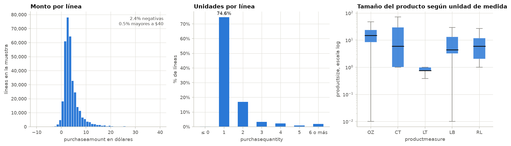

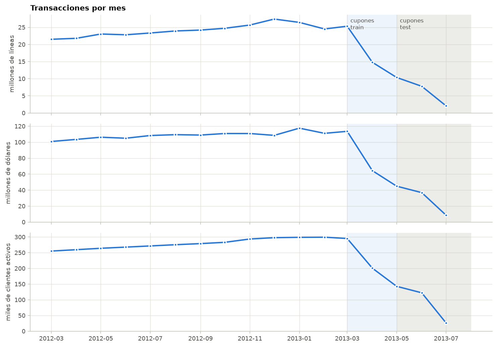

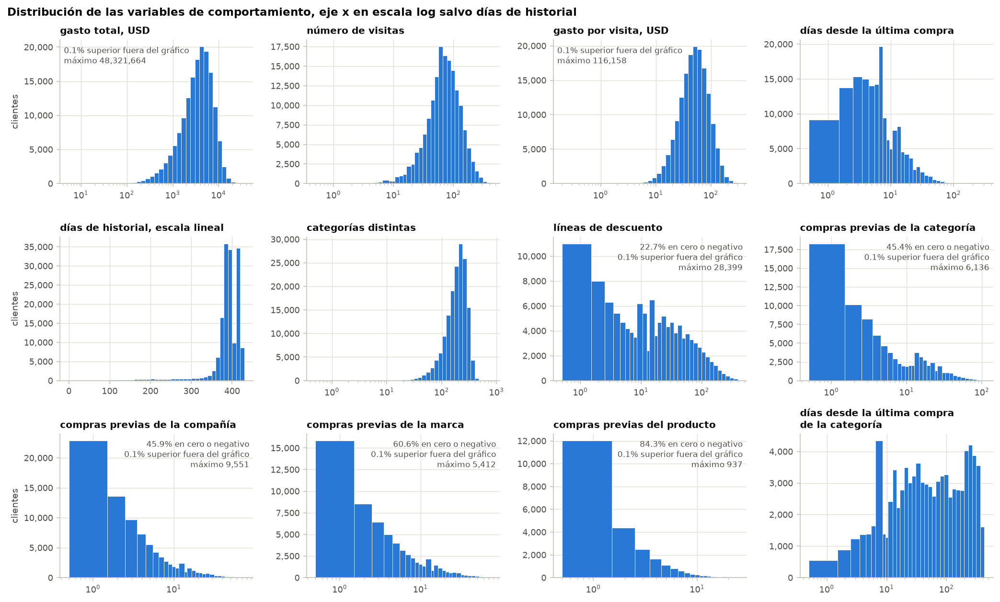

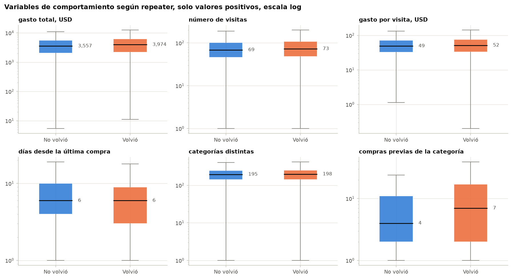

Las tasas por quintiles de recencia, frecuencia y monto permiten comparar comportamientos sin depender de la escala monetaria. El historial con el producto ofertado constituye el hallazgo central: la recompra es aproximadamente 24.2% entre quienes no habían comprado el producto y 42.8% entre quienes sí lo habían comprado. Esta asociación justifica mostrar el historial de producto en la aplicación, pero no garantiza por sí sola una predicción correcta para cada cliente.

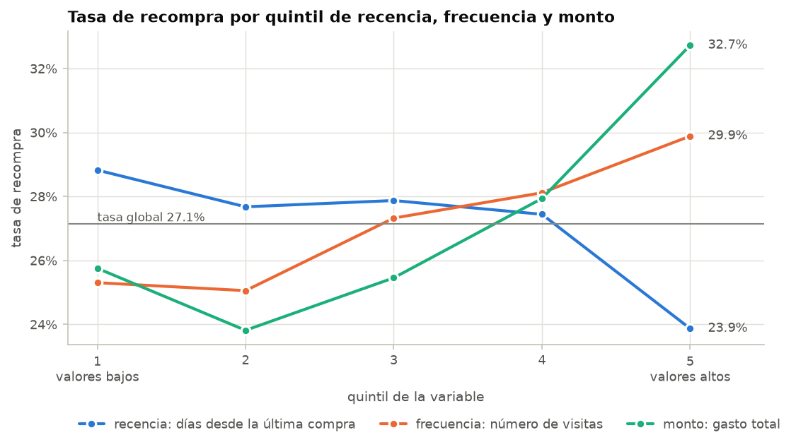

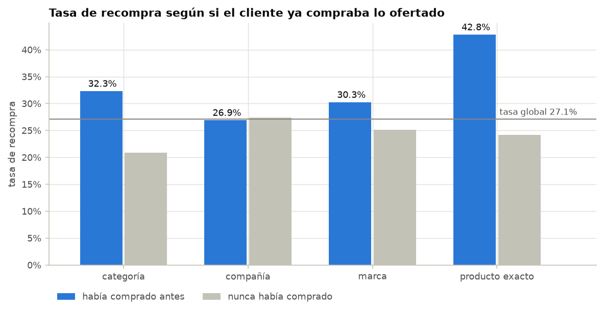

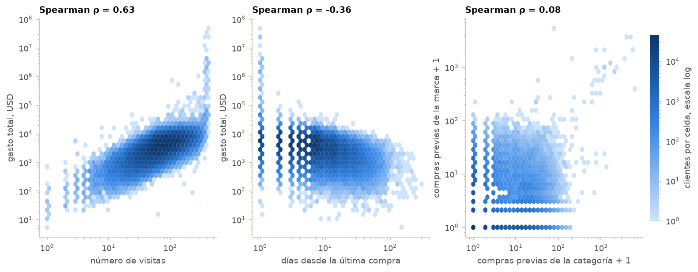

Se observaron 130 cadenas, 34 mercados, 13 categorías, 11 compañías y 12 marcas. Las figuras de frecuencia y de tasas por grupo indican el número de clientes de cada grupo, y las de tasas incluyen además la tasa global como referencia. Las cadenas y categorías se ordenan por tasa, mientras que los rangos de valor del descuento siguen su orden propio, de menor a mayor.

La cadena 21 concentra 27,373 clientes y presenta 25.14% de recompra. Las cadenas 64 y 166 alcanzan 47.22% y 54.42%, con 5,889 y 3,499 clientes; la cadena 46 registra 18.53%, con 5,440. Las figuras muestran los 15 grupos con más observaciones y mantienen las tablas completas como respaldo.

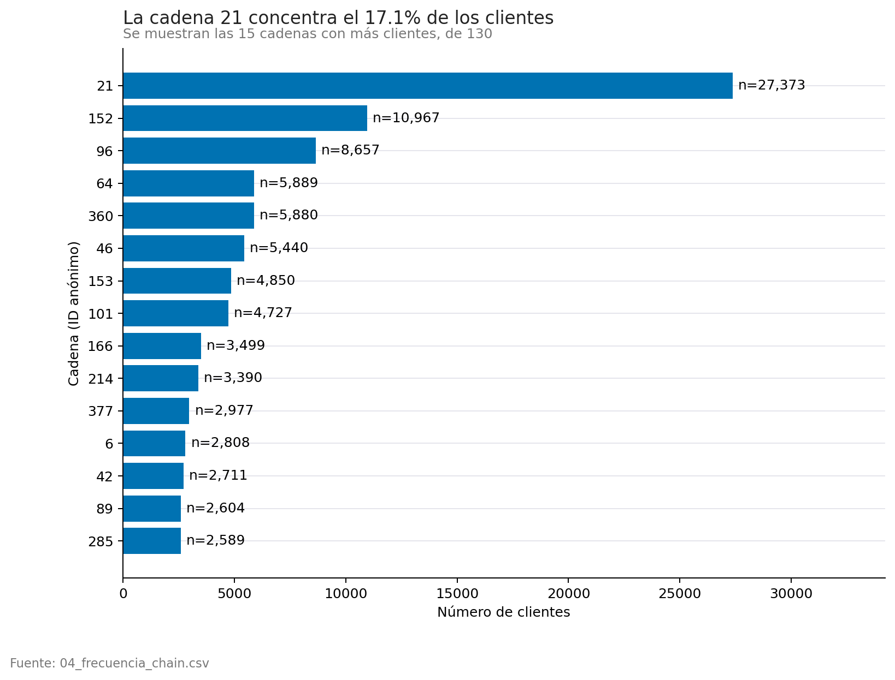

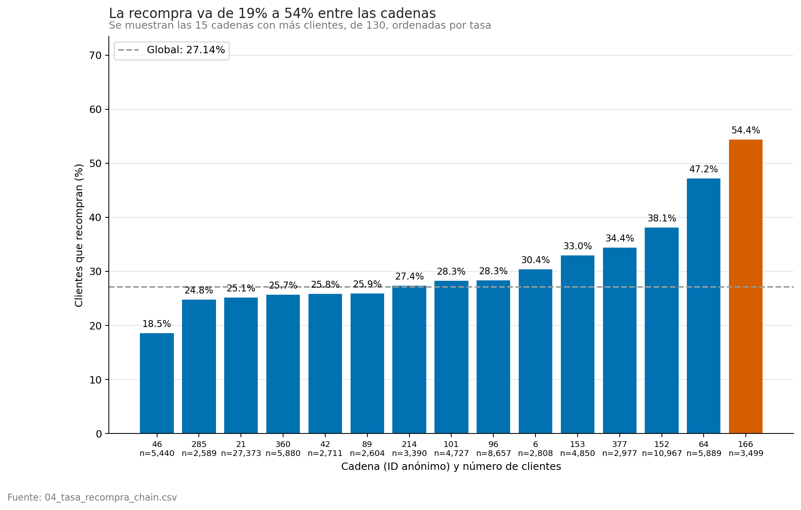

Las ofertas de hasta 1.00 registran 31.02% de recompra, con 93,859 clientes. Los intervalos 1.00–1.50 y 1.50–2.00 alcanzan 21.91% y 20.41%. El intervalo superior a 2.00 registra 30.47%, pero solo incluye 3,393 clientes: el tamaño acompaña la tasa para evitar interpretar grupos pequeños como evidencia equivalente.

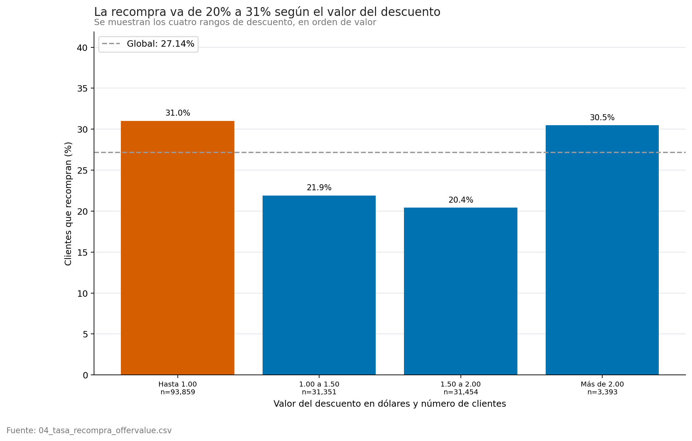

La categoría 9909 registra 44.93% con 22,147 clientes y la 2119, 43.44% con 18,767. La categoría más frecuente, 3203, registra 19.58% con 45,652 clientes. La categoría 4401 presenta 8.88%, con 15,008 clientes. Los códigos no permiten identificar productos ni explicar causalmente las diferencias.

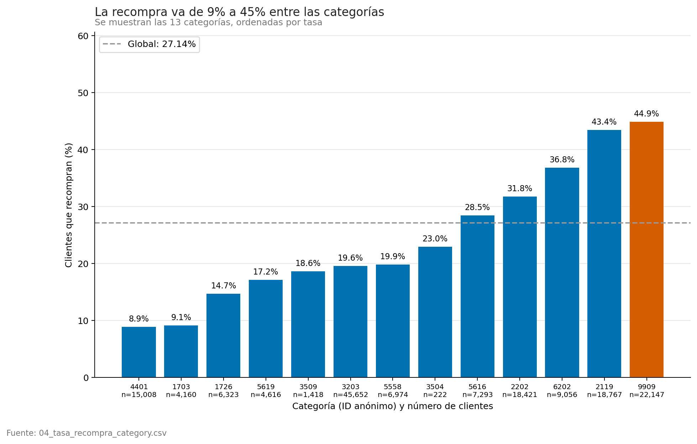

Las correlaciones de Spearman individuales con la recompra son limitadas: las mayores corresponden a compras previas de categoría, alrededor de 0.164. La matriz conserva el signo y una escala de −1 a 1 para distinguir asociaciones inversas y directas.

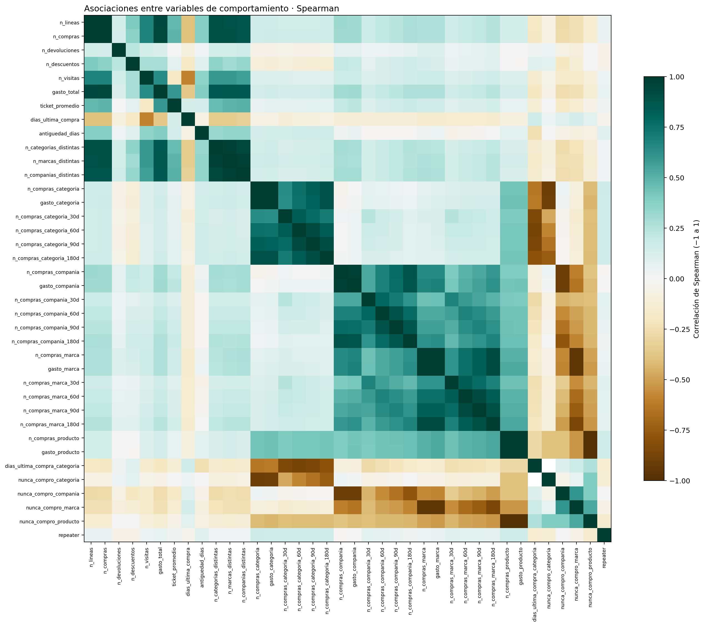

La recencia de categoría tiene 72,639 faltantes (45.38%): corresponden a ausencia de compras previas y se conservan junto a la bandera de historial. La última figura documenta los clientes con volumen extremo, que permanecen en el conjunto limpio; su preparación específica para cada algoritmo se presenta en la sección de ajuste.

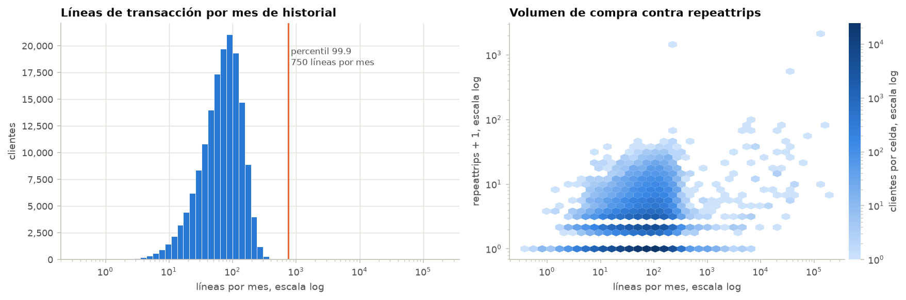

Fuentes: tablas 03 y 04 y secciones originales del análisis exploratorio del repositorio.
