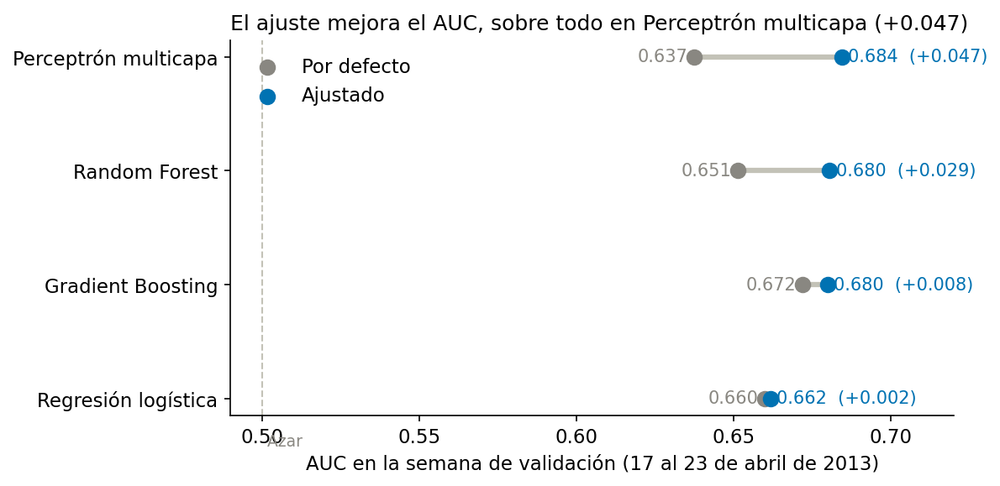
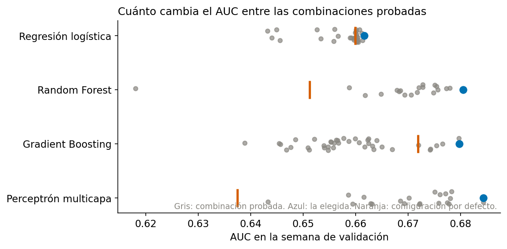
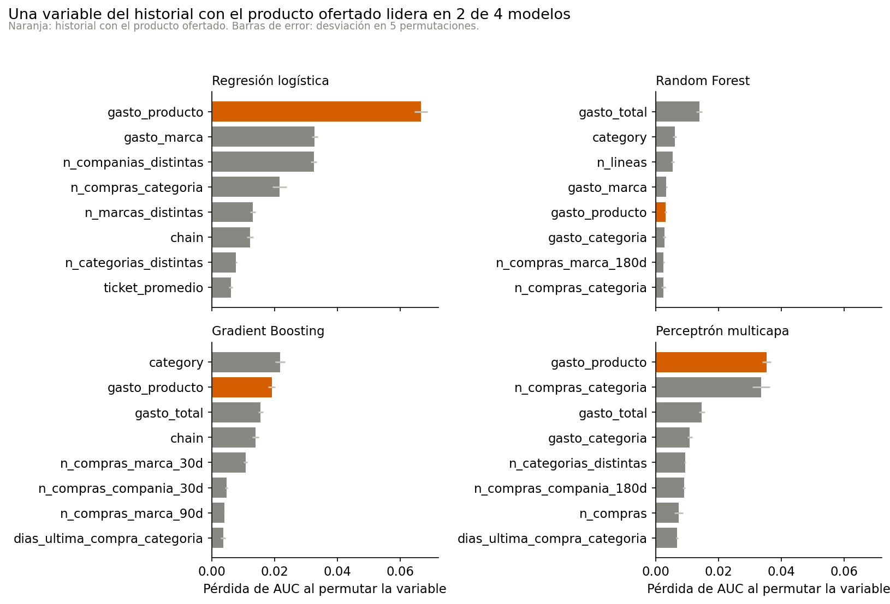

# Preparación de variables y ajuste de parámetros

## Conjuntos de datos

Los modelos se ajustaron con tres bloques ordenados en el tiempo. El entrenamiento contiene 106,062 clientes con ofertas del 1 de marzo al 16 de abril de 2013 y una tasa de recompra de 23.08%. La validación contiene 18,496 clientes del 17 al 23 de abril, con 33.60% de recompra, y sirvió para elegir los hiperparámetros. La prueba contiene 35,499 clientes del 24 al 30 de abril, con 35.91% de recompra, y no se usó en este paso. La tabla completa está en [la división en tres conjuntos](../../results/tables/07_division_conjuntos.csv).

## Modelos finales: reentrenamiento con la semana de validación

Los hiperparámetros se eligieron con modelos entrenados hasta el 16 de abril. Esos modelos, la versión 1, no vieron la semana de validación, que es la más parecida a la de prueba: 33.60% de recompra frente a 35.91%, y 23.08% en el entrenamiento. Por eso, una vez elegida la configuración de cada algoritmo, se reentrenó con el entrenamiento y la validación juntos, del 1 de marzo al 23 de abril, con 124,558 clientes. Estos modelos son la versión 2 y son los modelos finales. Conservan los mismos hiperparámetros y el mismo umbral de clasificación que la versión 1, porque el umbral no puede recalcularse con una semana que el modelo ya vio.

La semana de prueba no se usó en este cuaderno. Cabe aclarar que la decisión de reentrenar se tomó después de conocer el AUC de la versión 1 en la prueba, por lo que se reportan ambas versiones. El AUC de validación de los modelos de la versión 2 no mide nada, porque ya entrenaron con esa semana; la comparación entre modelos se hace con el AUC de la semana de prueba.

## Preparación de variables por algoritmo

Todos los modelos reciben las mismas 44 columnas de entrada de `dataset_modelo.csv` y calculan por dentro las variables derivadas, como las tasas por 30 días y las proporciones de compra. Lo que cambia entre algoritmos es la preparación que cada uno necesita. Todas las transformaciones se ajustan solamente con el entrenamiento y quedan guardadas dentro del mismo pipeline, de modo que un cliente nuevo se transforma igual que los de entrenamiento.

| Algoritmo | Faltantes | Escala de las variables | Cadena, mercado, categoría, compañía y marca | Desbalance de clases |
|---|---|---|---|---|
| Regresión logística | Mediana y columna que marca el faltante | Logaritmo con signo y estandarización | Una columna binaria por grupo, con los grupos de menos de 50 clientes agrupados | Se ajustó entre pesos balanceados y sin pesos |
| Random Forest | Mediana y columna que marca el faltante | Sin cambios, porque los árboles no dependen de la escala | Una columna binaria por grupo, con el mismo agrupamiento | Se ajustó entre pesos balanceados, balanceados por árbol y sin pesos |
| Gradient Boosting | El modelo usa los faltantes tal como vienen | Sin cambios | Códigos ordinales que el modelo trata como grupos, sin imponer un orden | Se ajustó entre pesos balanceados y sin pesos |
| Perceptrón multicapa | Mediana y columna que marca el faltante | Logaritmo con signo y estandarización | Una columna binaria por grupo, con el mismo agrupamiento | La implementación no admite pesos; se usa el AUC, que no depende del umbral |

La transformación logarítmica y la estandarización solo se aplican a la regresión logística y al perceptrón, que son sensibles a la escala y a las colas largas que mostró el análisis exploratorio. Los dos modelos de árboles conservan las variables en su escala original.

## Búsqueda de hiperparámetros

Se usó búsqueda aleatoria, que según Bergstra y Bengio (2012) encuentra configuraciones tan buenas o mejores que una rejilla con el mismo costo de cómputo. Cada combinación se entrenó con el bloque de entrenamiento, hasta el 16 de abril, y se puntuó con el AUC de la semana de validación. Se probaron 30 combinaciones para la regresión logística, 20 para Random Forest, 40 para Gradient Boosting y 20 para el perceptrón. Los rangos siguen la revisión bibliográfica y todas las combinaciones probadas están en [la tabla de búsqueda](../../results/tables/07_busqueda_hiperparametros.csv).

Como referencia se entrenó cada algoritmo con la configuración por defecto de scikit-learn y la misma preparación de variables. La comparación con la configuración ajustada es la siguiente.

| Algoritmo | AUC por defecto | AUC ajustado | Mejora |
|---|---|---|---|
| Regresión logística | 0.660 | 0.662 | +0.002 |
| Random Forest | 0.651 | 0.680 | +0.029 |
| Gradient Boosting | 0.672 | 0.680 | +0.008 |
| Perceptrón multicapa | 0.637 | 0.684 | +0.047 |

El ajuste ayudó más a los algoritmos con más hiperparámetros sensibles. El perceptrón mejoró 0.047 y el Random Forest 0.029, mientras que la regresión logística casi no cambió, porque su configuración por defecto ya era razonable. Gradient Boosting partió de la mejor configuración por defecto y mejoró 0.008. Las cifras de las tablas están en [la mejora por ajuste](../../results/tables/07_mejora_por_ajuste.csv).

Los valores elegidos fueron los siguientes.

- **Regresión logística:** penalización L2, C de 0.546 y pesos balanceados.
- **Random Forest:** 563 árboles, profundidad máxima de 24, mínimo de 44 clientes por hoja, 20% de las variables en cada división y sin pesos por clase.
- **Gradient Boosting:** tasa de aprendizaje de 0.187, máximo de 17 hojas, mínimo de 20 clientes por hoja, regularización L2 de 0.034, pesos balanceados y detención temprana.
- **Perceptrón multicapa:** dos capas ocultas de 64 y 32 neuronas, alfa de 0.0023, tasa de aprendizaje inicial de 0.00058 y detención temprana.

Dos precauciones al leer estas cifras. Primero, la configuración ajustada se eligió por su AUC en la semana de validación, así que ese valor es algo optimista; la medida que se reporta para comparar los modelos es la de la semana de prueba. Segundo, la semana de validación tiene una tasa de recompra de 33.60% frente a 23.08% en el entrenamiento, por lo que parte de las diferencias entre configuraciones puede deberse a ese cambio de comportamiento y no solo al algoritmo.

## Variables que sostienen las predicciones

Para saber qué variables usa cada modelo se permutó cada una de las 44 columnas de entrada en la semana de validación y se midió cuánto AUC pierde el modelo congelado. Una pérdida grande indica que el modelo depende de esa variable. Cada medida es el promedio de cinco permutaciones. Los valores están en [la importancia por permutación](../../results/tables/07_importancia_permutacion.csv).

El gasto previo en el producto ofertado es la variable más importante de la regresión logística, con una pérdida de 0.067, y del perceptrón, con 0.035. En Gradient Boosting ocupa el segundo lugar, con 0.019, detrás de la categoría del producto. En el Random Forest el primer lugar es el gasto total, con 0.014, y el gasto en el producto queda en quinto lugar. Es decir, el historial con el producto ofertado, que fue el hallazgo central del análisis exploratorio, sigue entre las variables de mayor peso en tres de los cuatro modelos. El Random Forest reparte el peso entre más variables, ninguna con una pérdida mayor de 0.014.

Las pérdidas son pequeñas en todos los casos. Eso es coherente con un AUC cercano a 0.68: ninguna variable por sí sola explica la recompra y la señal está repartida entre muchas.
