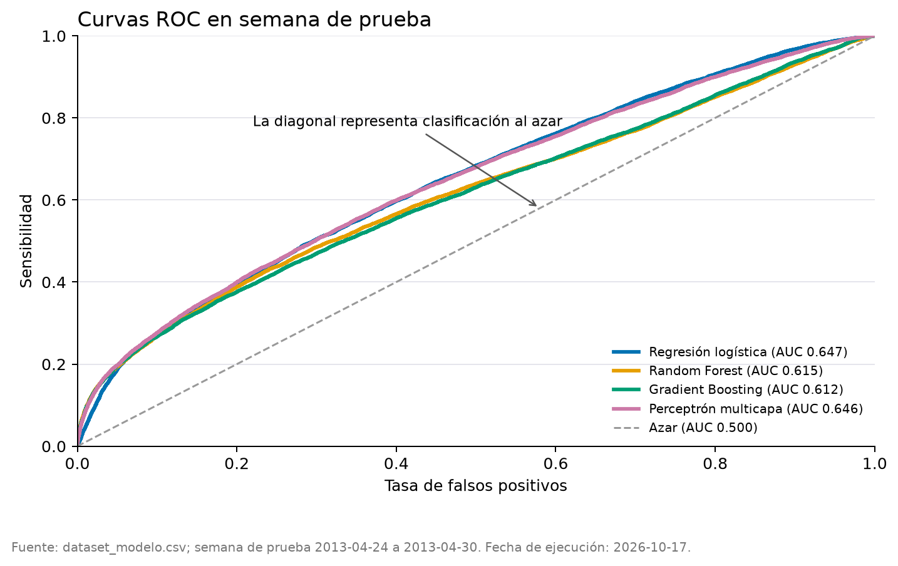
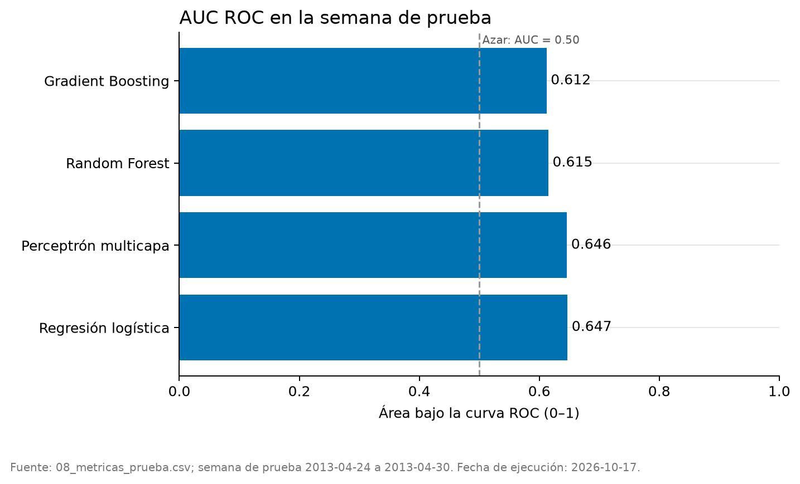
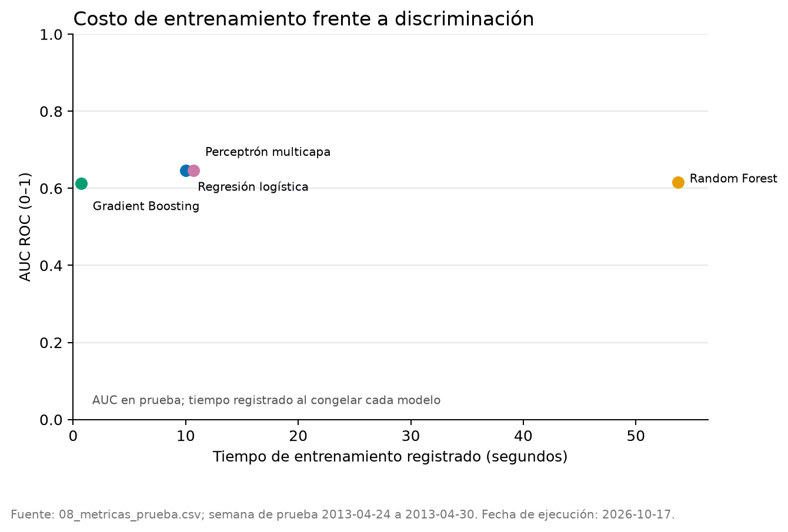
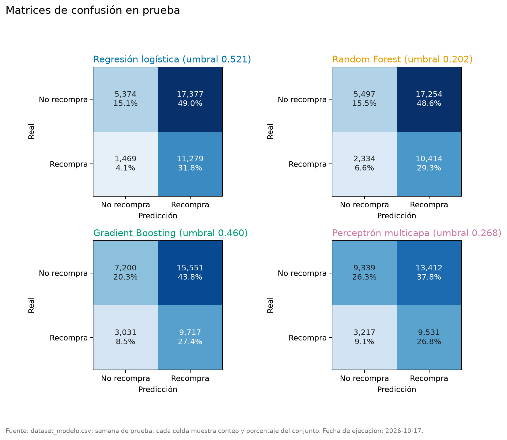
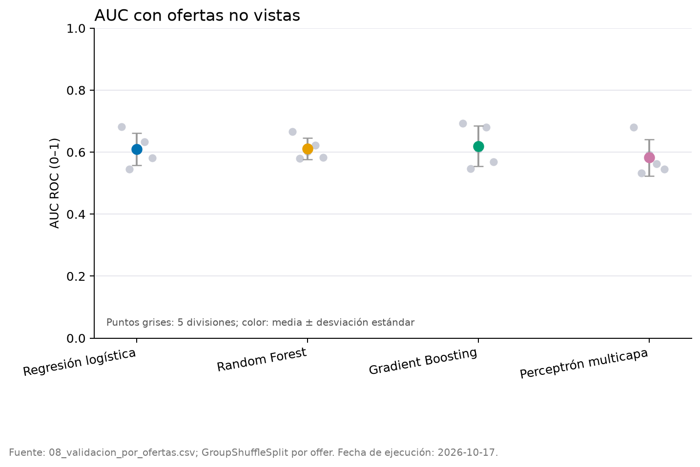

# Comparación de los algoritmos

## Protocolo de evaluación

Los cuatro modelos versión 2 se reentrenaron con los datos del 1 de marzo al 23 de abril de 2013, conservando los hiperparámetros y umbrales elegidos previamente en validación. Después se evaluaron una sola vez en la semana de prueba, del 24 al 30 de abril, formada por 35,499 clientes. La prueba no intervino en el ajuste. El AUC fue la medida principal; precisión, sensibilidad y F1 se calcularon con el umbral de validación propio de cada modelo.

| Modelo | AUC | Precisión | Sensibilidad | F1 | Entrenamiento (s) | Predicción (s) |
|---|---:|---:|---:|---:|---:|---:|
| Regresión logística | **0.6470** | 0.3936 | **0.8848** | **0.5448** | 10.02 | 0.10 |
| Perceptrón multicapa | 0.6461 | **0.4154** | 0.7476 | 0.5341 | 10.69 | 0.12 |
| Random Forest | 0.6151 | 0.3764 | 0.8169 | 0.5153 | 53.74 | 0.34 |
| Gradient Boosting | 0.6121 | 0.3846 | 0.7622 | 0.5112 | **0.70** | **0.07** |

La regresión logística obtuvo el mayor AUC y F1, aunque su ventaja de AUC frente al perceptrón fue de solo 0.0009. El perceptrón logró la mayor precisión y produjo menos clasificaciones positivas. Por ello, ambos modelos muestran una capacidad de discriminación prácticamente equivalente; la elección entre ellos depende del costo de contactar clientes adicionales.

El AUC 0.645 del modelo logístico anterior se obtuvo sobre la misma semana de prueba y con entrenamiento hasta el 23 de abril. Frente a esa referencia comparable, la regresión logística versión 2 mejoró 0.0020 y el perceptrón 0.0011; Random Forest y Gradient Boosting quedaron 0.0299 y 0.0329 por debajo, respectivamente.

## Costo de cómputo y elección

Gradient Boosting fue el más rápido, con 0.70 segundos de entrenamiento y 0.07 segundos de predicción, pero obtuvo el menor AUC. La regresión logística y el perceptrón necesitaron cerca de 10 segundos para entrenarse y superaron 0.646 de AUC. Se toma la regresión logística como modelo de referencia por alcanzar el mayor AUC, sensibilidad y F1, sin una carga de cómputo relevante. El perceptrón es una alternativa razonable si se prefiere reducir la cantidad de clientes clasificados como recompra.

## Errores de clasificación

Las matrices usan el umbral seleccionado en validación para cada modelo, igual que la tabla principal. La regresión logística clasificó como recompra al 80.7% de los clientes; el perceptrón, al 64.6%; Random Forest, al 77.9%; y Gradient Boosting, al 71.2%. Estas proporciones explican la sensibilidad alta y la precisión moderada: los umbrales favorecen detectar recompradores, pero también generan falsos positivos. Antes del despliegue deben recalibrarse según el costo del descuento y el valor esperado de una recompra, sin usar la semana de prueba para optimizarlos.

## Ofertas no vistas

En la semana de prueba hubo 1,334 clientes con ofertas vistas y 34,165 con ofertas no vistas; estas últimas representaron 96.3% del conjunto. Los AUC en ofertas vistas fueron 0.6589 para regresión logística, 0.6861 para Random Forest, 0.6717 para Gradient Boosting y 0.6611 para el perceptrón. En ofertas no vistas fueron 0.6421, 0.6100, 0.6076 y 0.6413, respectivamente. La regresión logística y el perceptrón mostraron la menor degradación, de 0.0169 y 0.0198.

En cinco divisiones `GroupShuffleSplit` que reservaron ofertas completas, Gradient Boosting obtuvo el mayor AUC medio, aunque también la mayor variación:

| Modelo | AUC medio | Desviación estándar | Mínimo | Máximo |
|---|---:|---:|---:|---:|
| Gradient Boosting | **0.6197** | 0.0659 | 0.5460 | 0.6934 |
| Random Forest | 0.6107 | **0.0349** | 0.5803 | 0.6654 |
| Regresión logística | 0.6090 | 0.0518 | 0.5454 | 0.6820 |
| Perceptrón multicapa | 0.5824 | 0.0590 | 0.5321 | 0.6800 |

La diferencia entre la prueba temporal y las divisiones por oferta indica que el resultado depende del tipo de cambio futuro evaluado. La regresión logística generalizó mejor a la semana posterior, mientras que Gradient Boosting obtuvo el mejor promedio al simular campañas con ofertas completamente nuevas.

## Reproducibilidad

Las cifras provienen de `results/tables/08_metricas_prueba.csv`, `08_predicciones_prueba.parquet` y `08_validacion_por_ofertas.csv`, generadas por el notebook 08 ejecutado con `cargar_modelos(version=2)`. Las predicciones individuales permiten reconstruir las curvas ROC y matrices sin reentrenar los modelos.
