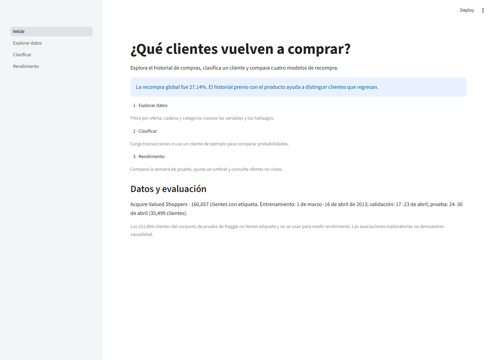
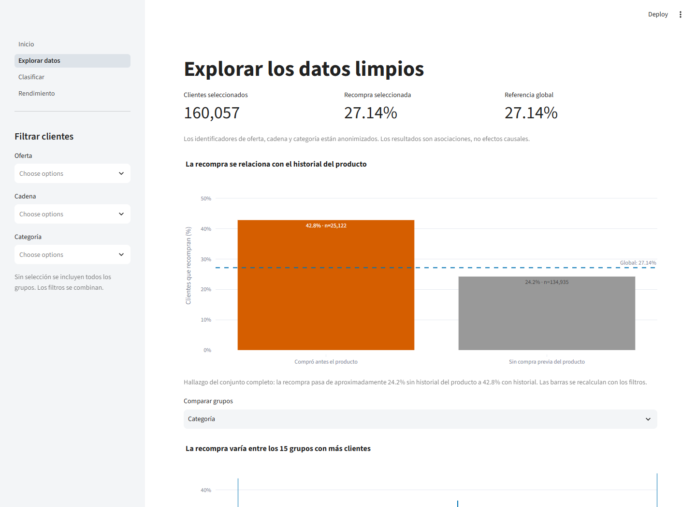
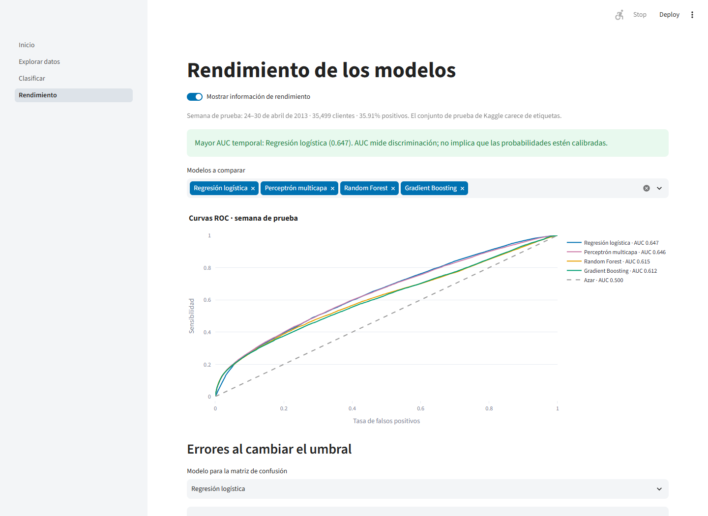
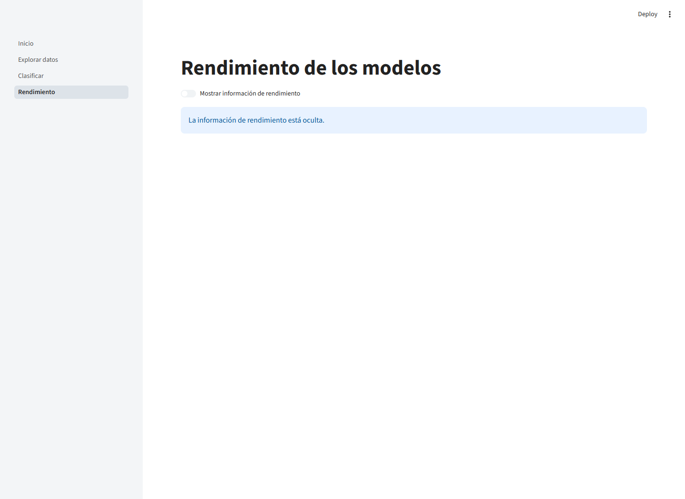

# Resultados: aplicación interactiva

La aplicación permite recorrer tres tareas desde Inicio: explorar el conjunto limpio, clasificar clientes y consultar el rendimiento. Se implementó con Streamlit para reutilizar los módulos de Python del proyecto, el preprocesamiento y los modelos congelados; Plotly permite consultar puntos, seleccionar series y ampliar rangos sin generar nuevas imágenes. Los datos de exploración y evaluación se almacenan en caché y se invalidan cuando cambia el archivo de origen. Las páginas de exploración y rendimiento no cargan modelos.

## Exploración del conjunto limpio

Explorar datos ofrece filtros combinables de oferta, cadena y categoría, indicadores del tamaño de selección y la recompra, y una referencia global fija de 27.14%. Una primera gráfica compara clientes con y sin historial de compra del producto. Las tasas y tamaños se recalculan con cada selección; la anotación aclara el hallazgo del conjunto completo. Una segunda gráfica compara las tasas de los 15 grupos más frecuentes de la dimensión elegida. La distribución de variables prioriza las entradas declaradas en el manifiesto de modelos y permite consultar faltantes, estadísticas y el diccionario. La página permite descargar los clientes filtrados. Si una combinación no tiene datos, muestra un mensaje y permite corregir los filtros.

## Clasificación de datos nuevos

La página Clasificar acepta las transacciones de un cliente o un cliente de ejemplo, prepara las entradas con las mismas funciones del entrenamiento y compara las probabilidades de uno o de todos los algoritmos congelados. Su funcionamiento, sus reglas de validación y su verificación se describen en el apartado siguiente.

## Rendimiento interactivo

Rendimiento lee las métricas, probabilidades y divisiones agrupadas de las tres tablas de evaluación. Muestra curvas ROC de los modelos seleccionados, una matriz de confusión con umbral ajustable, precisión, sensibilidad y F1 recalculados, y una comparación de las métricas oficiales. Las métricas oficiales conservan los umbrales elegidos en validación; el control de umbral es exploratorio y no cambia la evaluación oficial ni selecciona hiperparámetros con la prueba. La AUC permanece independiente del umbral.

Se distingue explícitamente la semana de prueba temporal, del 24 al 30 de abril de 2013, de la validación agrupada por oferta. Esta última muestra la media y desviación estándar de AUC y el número de divisiones. También se presentan las AUC temporales por ofertas vistas y no vistas cuando están disponibles. El conjunto de prueba de Kaggle carece de etiquetas y no se presenta como una evaluación supervisada.

Un interruptor situado antes de los resultados oculta toda la información de rendimiento. Si faltan las tablas requeridas, la página muestra cómo generarlas, sin entrenar ni estimar resultados de reemplazo.

## Color y presentación

Se utiliza la paleta Okabe-Ito del módulo común de estilo del proyecto. El azul `#0072B2` guía la navegación y las comparaciones generales; el bermellón `#D55E00` destaca el hallazgo y el gris proporciona contexto. Regresión logística, Random Forest, Gradient Boosting y perceptrón multicapa conservan sus colores azul, naranja, verde y rosa en todas las páginas. Nombres, cifras y etiquetas acompañan el color para no depender de su percepción. Las barras de tasas parten de cero y la correlación utiliza una escala divergente centrada en cero. El tema tiene fondo claro, texto oscuro y rejillas discretas.

## Selección de las tecnologías

La aplicación se construyó sobre el mismo entorno de Python del análisis para reutilizar la preparación de los datos y los modelos entrenados. Las tecnologías se eligieron según las tareas que debía realizar el usuario:

| Tecnología | Uso en la aplicación | Razón de la selección |
|---|---|---|
| Python | Integra la lectura de datos, el preprocesamiento y las predicciones | Permite compartir las funciones del proyecto y mantener los mismos cálculos al clasificar clientes nuevos |
| Streamlit | Navegación entre páginas, filtros, carga de CSV, controles y tablas | Permite construir la interfaz desde Python e incorporar directamente las funciones de análisis; su caché evita repetir cargas de datos y modelos en cada interacción |
| pandas y NumPy | Lectura y filtrado de tablas, preparación de entradas y operaciones numéricas | Son compatibles con las estructuras usadas durante el entrenamiento y permiten recalcular los resúmenes de la selección del usuario |
| Plotly | Gráficas de exploración, probabilidades, curvas ROC y matriz de confusión | Permite consultar valores al pasar el cursor, ampliar rangos y mostrar u ocultar series para comparar algoritmos |
| scikit-learn y joblib | Predicciones de los modelos guardados y cálculo de métricas | Reutilizan los estimadores y sus transformaciones del entrenamiento; los archivos conservan los modelos para consultarlos sin volver a entrenar |
| CSV y Parquet, con PyArrow | Intercambio de conjuntos de datos, métricas y probabilidades | CSV facilita revisar y descargar tablas; Parquet conserva tipos y reduce el espacio de las tablas de mayor volumen |

Las versiones están fijadas en `requirements.txt` para reproducir el entorno. La compatibilidad de los modelos guardados se comprueba antes de predecir. La aplicación se ejecuta con `python -m streamlit run app/Inicio.py` desde la raíz del repositorio y se consulta en el navegador.

En conjunto, estas herramientas permiten probar los cuatro algoritmos sobre un mismo cliente, comparar sus probabilidades y consultar su desempeño en clientes con respuesta conocida. La clasificación usa modelos ya entrenados; los controles de rendimiento permiten explorar los resultados de evaluación existentes.

## Verificación y alcance

Las páginas se verificaron con pruebas automáticas que abren cada una y ejercitan sus controles: los filtros, una combinación de filtros sin clientes, el cambio de umbral, la selección vacía de modelos y el interruptor que oculta el rendimiento. Además, las AUC recalculadas con las probabilidades guardadas coinciden con las de la evaluación en los cuatro modelos. La comparación de variables y probabilidades de la página Clasificar en 100 clientes se describe en el apartado siguiente.

Estas comprobaciones no sustituyen una prueba de uso con personas. La prueba con una persona externa al grupo queda pendiente.
