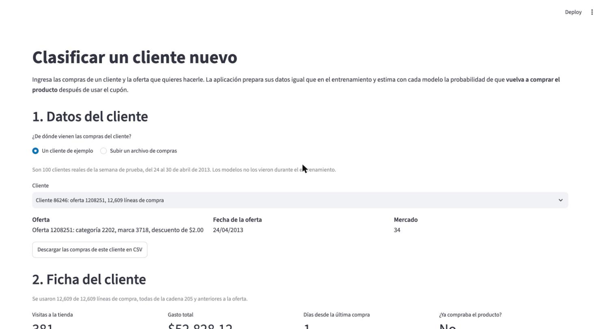
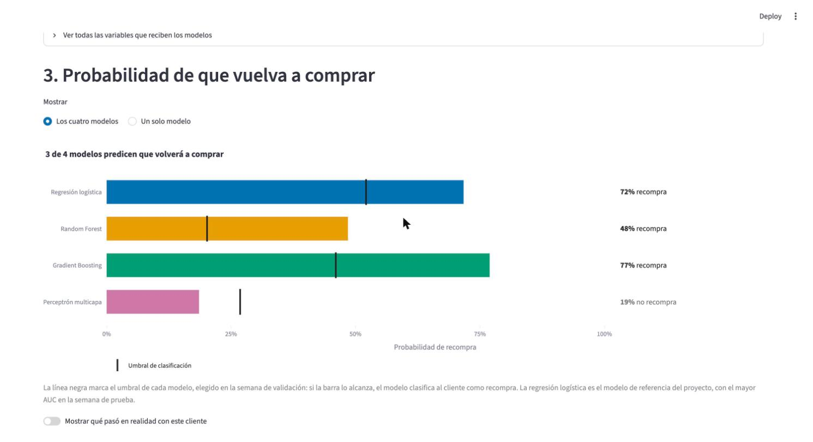

# Aplicación: ingreso y clasificación de clientes nuevos

La página Clasificar permite ingresar los datos de un cliente nuevo y ver la probabilidad de que vuelva a comprar según cada algoritmo. Cubre dos requisitos de la guía: ingresar nuevos datos para que el sistema los clasifique con los modelos entrenados y ver el resultado de cada algoritmo por separado o de todos.

## Ingreso de los datos

El usuario puede ingresar al cliente de dos formas:

- **Un cliente de ejemplo.** La aplicación incluye 100 clientes reales de la semana de prueba, con sus 119,819 líneas de compra originales. Los modelos no vieron a estos clientes durante el entrenamiento. Al elegir uno, la página muestra su oferta, la fecha de la oferta y su mercado, y permite descargar sus compras en CSV como modelo del formato.
- **Un archivo propio.** El usuario sube un CSV con las compras de un cliente, en el formato de las transacciones de la competencia, y elige la oferta que se le hará, la fecha de la oferta y el mercado.

## Preprocesamiento invisible para el usuario

Las compras crudas no son lo que reciben los modelos: hay que resumirlas en una fila por cliente con las mismas variables del entrenamiento. Ese paso corre por detrás, en el módulo `src/entrada_app.py`, y el usuario solo ve el resultado en la ficha del cliente.

Para garantizar que un cliente nuevo se transforme exactamente igual que los clientes de entrenamiento, el módulo no reescribe ningún cálculo. Usa las mismas funciones de `src/preprocesamiento.py` que construyeron el conjunto de datos de los modelos, con las mismas reglas:

- Solo cuentan las compras en la cadena del cliente.
- Solo cuentan las compras anteriores a la fecha de la oferta, para no usar información del futuro.
- Si el cliente nunca compró la categoría, la compañía, la marca o el producto ofertado, esos conteos quedan en cero y se activa la bandera correspondiente.

Antes de calcular, el módulo revisa los datos y responde con un mensaje claro en lugar de un error del programa:

| Situación | Respuesta de la aplicación |
|---|---|
| El archivo no es un CSV o está vacío | Pide revisar el formato del archivo |
| Faltan columnas necesarias | Indica cuáles faltan |
| El archivo trae compras de varios clientes | Pide subir un solo cliente |
| Hay líneas con fechas o montos ilegibles | Las descarta y avisa cuántas fueron |
| Hay compras de otras cadenas | Usa solo la cadena con más compras y avisa |
| Hay compras en la fecha de la oferta o después | Las ignora y avisa |
| El cliente no tiene compras previas | Clasifica solo con los datos de la oferta y advierte que el resultado es menos confiable |

## Resultado de cada algoritmo

La página carga los cuatro modelos congelados de la versión 2 una sola vez y solo les pide predicciones; nunca los vuelve a entrenar. Antes de usarlos, el cargador comprueba que cada archivo no haya cambiado y que la versión de scikit-learn sea la misma con que se entrenaron.

El usuario elige ver los cuatro modelos o uno solo. Para cada modelo, la gráfica muestra:

- la probabilidad de recompra en una barra, con el color fijo de ese modelo en todo el proyecto;
- una línea negra en el umbral del modelo, elegido en la semana de validación;
- la clasificación final, recompra o no recompra, escrita junto a la barra.

El título de la gráfica resume la respuesta, por ejemplo "3 de 4 modelos predicen que volverá a comprar". Con un cliente de ejemplo, el usuario también puede revelar qué pasó en la realidad y compararlo con la predicción.

Debajo, una segunda gráfica conecta la predicción con el hallazgo central del análisis exploratorio. Entre los clientes que ya habían comprado el producto ofertado, el 42.8% volvió a comprar, frente al 24.2% de los que nunca lo habían comprado. La gráfica resalta el grupo al que pertenece el cliente, para que el usuario entienda por qué los modelos le asignan esa probabilidad.

## Verificación de la aplicación

Para comprobar que la aplicación prepara y clasifica igual que el entrenamiento, se procesaron los 100 clientes de ejemplo de la semana de prueba con el mismo módulo y los mismos modelos que usa la página. El script `src/verificar_entrada_app.py` hizo dos comparaciones:

1. **Variables.** Comparó las 46 variables que calcula la aplicación con las del conjunto de datos del entrenamiento. Coincidieron todas en los 100 clientes.
2. **Probabilidades.** Comparó la probabilidad de cada uno de los cuatro modelos con la que guardó el cuaderno de evaluación. La mayor diferencia fue de 3.3 × 10⁻¹⁶, que corresponde al redondeo de la computadora.

Los 100 clientes coincidieron en todo, lo que cumple la condición del objetivo específico 5. El resultado está en `results/tables/09_verificacion_app.csv`, y la comprobación se puede repetir con las pruebas automáticas de `tests/test_entrada_app.py`.
